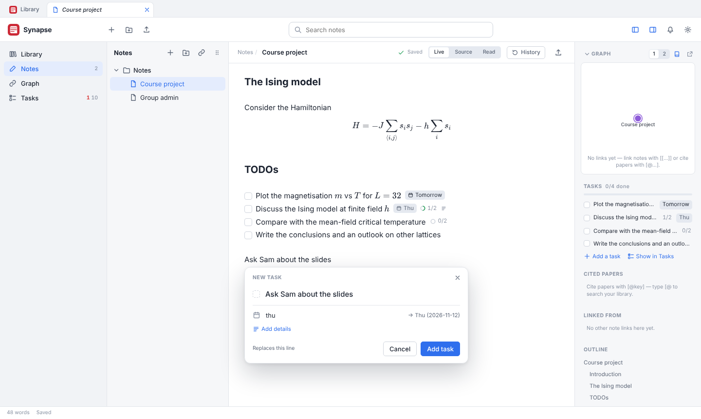
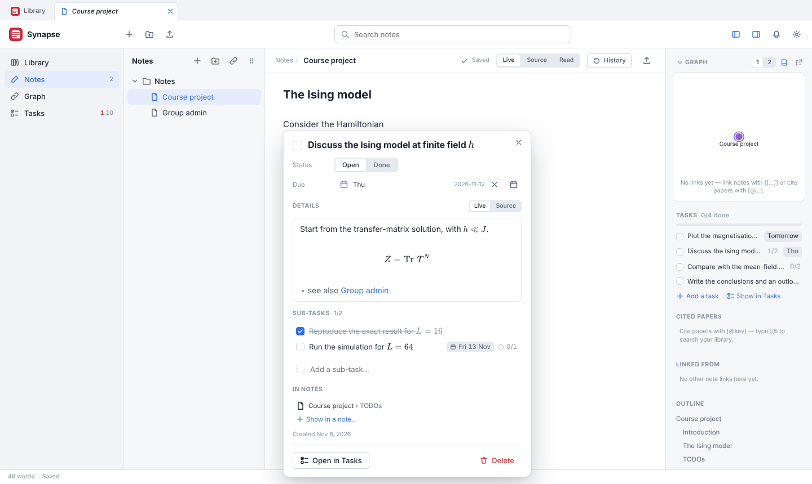
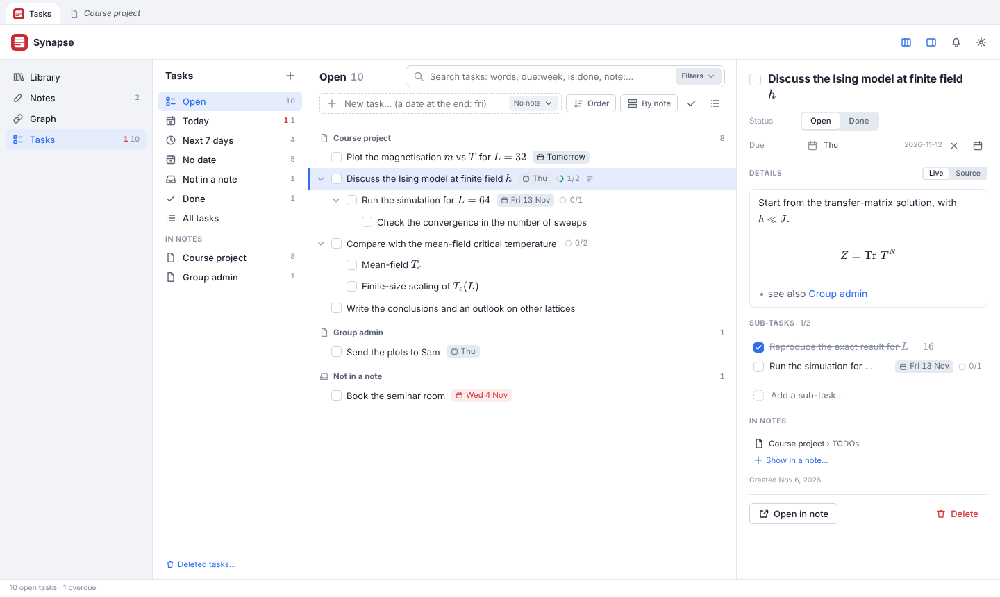

# Tasks

The **Tasks** contributed plugin (`plugins/tasks/`) owns the page, the note editor’s task controls,
and the HTTP and MCP interfaces. It is on by default and can be turned off in Settings → Plugins.
Turning it off hides its controls and Claude tools; note lines show their task IDs. Turning it
on restores the interface without changing any records. Storage, history, note validation,
attachment retention and backups remain in `backend/tasks/`, even while the plugin is off.

The `/api/tasks` URLs remain compatibility aliases for the plugin’s routes. They keep the same
request and response shapes and return 404 while Tasks is disabled.

A **task** is a to-do with a title, a status (open or done), an optional due date, a Markdown body
and sub-tasks to any depth. Tasks are records in `library.db`, not text in a note: a note *shows*
a task with a `{{task:<id>}}` line, which the editor draws as the task's checkbox and title.
Ticking the box or editing the body changes the task, never the note. Plain Markdown checkboxes
(`- [ ] …`) stay checkboxes.

### Task blocks in notes

The **Task blocks** extension in Extended Markdown shows several existing tasks without repeating
`{{task:…}}`. Put one task ID on each line of a `tasks` fence:

````markdown
```tasks table group=deadline completed=bottom
k7f3q2mx
m4n8p1rs
```
````

The first option is `list` (default) or `table`. `group=deadline` groups dated tasks and leaves
undated ones last (`group=none` is the default). `completed=bottom` is the default;
`completed=inline` keeps source order and `completed=hide` omits completed tasks. A leading `- `
before an ID is accepted. Unknown options and invalid lines are ignored.

The block is live in the editor and Read mode: boxes tick tasks and titles open them. Its toolbar
filters All/Open/Done, cycles through manual/deadline/title order, and **Add task** creates a task
and appends its ID before that fence's closing marker. These controls are presentation state and
do not rewrite the block options. It is static
but fully rendered in HTML/PDF export. Portable Markdown export expands it to ordinary checkbox
items. The notes parser always indexes the IDs inside the fence, even when Extended Markdown is
off, so the Tasks page and note/task relationships remain correct. With the extension off the
fence is ordinary code and no task data changes.

This page covers the records (`backend/tasks/store.py`), the lines in notes
(`backend/tasks/service.py` and the notes parser), the HTTP API (`plugins/tasks/server/routes.py`), Claude's
task tools, and the frontend (`plugins/tasks/frontend/`). Related pages: [notes](notes.md) (the
parser and the editor), [storage](storage.md) (the tables and backups), [mcp](mcp.md).

## Using tasks

| A new task in a note | A task opened from its line | The Tasks page |
|---|---|---|
|  |  |  |

- **In a note.** <kbd>Cmd/Ctrl</kbd>+<kbd>Enter</kbd> (or **Add Task to This Note…** in the command palette) opens the
  *New task* popup. On a line with text, that text is the title, and the task's line takes the
  line's place (a checkbox item's `- [ ]` goes with it); otherwise the line goes below the cursor. Give a due date in words ("fri", "27 oct",
  "in 3 days", "next week") and, under **Add details**, a body. As you type a title, tasks you
  already have and that match are offered (<kbd>↓</kbd> picks one): the note then shows that task.
  On a line that shows a task, <kbd>Cmd/Ctrl</kbd>+<kbd>Enter</kbd> ticks it. With checkbox lines
  selected, it turns them into tasks (see [Turning checkboxes into tasks](#turning-checkboxes-into-tasks)).
- **Referring to a task you already have**, as `[@` does for papers: type `{{task` and some words
  of its title. The list shows the matching tasks (rendered titles, their date, and where they are
  already shown); <kbd>Enter</kbd> writes the chosen task's line. The last entry, *New task “…”*,
  makes a task with the words typed instead. `{{` alone offers nothing.
- **A task line** shows the checkbox, the title (math, citations and links rendered) and small
  labels: the due date (red when overdue, amber today), sub-task progress ("1/2") and a mark when
  it has details. The box ticks it; the title opens the task in a popup (title, status, date,
  details with the notes editor, sub-tasks, the notes that show it, Open in Tasks, Delete). In the
  live preview a task line never shows its `{{task:…}}` source: the cursor steps over it, and
  <kbd>Backspace</kbd> after it takes it out of the note in one go.
- **Taking a task's line out of a note** leaves the task in Tasks (under *Not in a note* if no
  other note shows it), except for a task made by mistake: one made from this note since the app
  was opened (New task popup, *New task “…”* in the `{{task` list, or turned from checkboxes),
  that is not a sub-task and that no other note shows. When the note is saved without its line,
  such a task goes to the trash, with a toast and Undo (Undo keeps the task, outside the note).
  If its line comes back (Cmd/Ctrl+Z in the note, or the line put into another note), the task
  is restored, so moving a new task to another note by cutting and pasting its line works. This
  bookkeeping lives in the page (`fresh` and `binned` in `noteTasks.ts`) and is lost on reload,
  which is the point: older tasks never go away because a line did.
- **The side panel** of a note lists its tasks with a progress bar, **Add a task** and **Show in
  Tasks**.
- **The Tasks page** (**Tasks** under **Plugins** in the left sidebar, <kbd>Cmd/Ctrl</kbd>+<kbd>Shift</kbd>+<kbd>K</kbd>):
  - *Views*: Open, Today (overdue and due today), Next 7 days, No date, Not in a note, Done, All
    tasks; then each note that shows tasks, and Deleted tasks… at the bottom.
  - *The list*: sub-tasks under their parent (fold with the arrow). Search with words and filters
    (below), **Sort** (order in the notes, due date, title, created, changed, done) — sorting orders
    siblings, sub-tasks stay under their parent, and a parent sorts by its earliest open sub-task —
    and **Group** (by note, by due date, none). The ✓ button shows done sub-tasks in open views; the
    list button shows matches without the tree.
  - *Quick add* at the top: a title with a date at the end ("Book the room next week"), into no
    note or a note picked from its menu.
  - *Details* on the right: the same form as the popup. Several selected tasks: mark done, due
    date, show in a note, delete.
  - *Keyboard*: <kbd>↑</kbd>/<kbd>↓</kbd> (with <kbd>Shift</kbd> to extend), <kbd>←</kbd>/<kbd>→</kbd> fold,
    <kbd>Space</kbd> tick, <kbd>Enter</kbd> rename, <kbd>N</kbd>/<kbd>Shift</kbd>+<kbd>N</kbd> new task below / sub-task,
    <kbd>Tab</kbd>/<kbd>Shift</kbd>+<kbd>Tab</kbd> indent/outdent, <kbd>Alt</kbd>+<kbd>↑</kbd>/<kbd>↓</kbd> reorder,
    <kbd>D</kbd> due date, <kbd>O</kbd> open in its note, <kbd>Delete</kbd>, <kbd>Cmd/Ctrl</kbd>+<kbd>Z</kbd> undo.
    Rows can be dragged onto another task (before, after or into it) and onto a note in the views
    column.
  - A task ticked on the page stays in the list, struck through, until the view or search changes,
    so <kbd>Space</kbd> ticks it back.
- **Ticking a parent** whose sub-tasks are still open asks first: *Mark all* or *Only this one*.
  Ticking the last open sub-task never ticks the parent.

### Search syntax

The Tasks page and `list_tasks` understand the same filters:

| Filter | Meaning |
|---|---|
| words, `"a phrase"`, `-word` | in the title or body; `-` excludes |
| `is:open`, `is:done` | status |
| `due:today`, `due:overdue`, `due:week`, `due:none`, `due:<2026-11-01`, `due:>2026-10-25`, `due:2026-10-27` | due date (`week`: within seven days, overdue included) |
| `note:"Steady-state"` | shown in a note whose title or path contains the words |
| `has:body`, `has:subtasks` | has details, has sub-tasks |

## The records (`backend/tasks/store.py`)

`TaskStore` keeps two tables in `library.db`. It registers its `SCHEMA` with
`Database.add_schema`, so `Database.migrate` (also run after restoring a backup) creates them.
Tasks are therefore in every library backup, restored together with the items and the notes that
show them, and other windows and devices hear about changes through the change feed like any
other `library.db` write.

| Column | Meaning |
|---|---|
| `id` | 8 characters from `abcdefghjkmnpqrstuvwxyz23456789` (no 0/o, 1/l/i), starting with a letter (`new_id`). |
| `parent_id`, `position` | The tree: `NULL` at the top level; `position` (a float) orders siblings. `_position` puts a task before or after a sibling by taking the midpoint, and renumbers the siblings when two positions get too close. |
| `title` | One line of inline Markdown (`clean_title` joins lines and spaces), at most 500 characters. |
| `body` | Markdown (any length up to 200,000 characters); line endings normalised to `\n`. |
| `status` | `open` or `done` (`STATUSES`). `done_at` is set when it becomes `done` and cleared when it reopens. |
| `due` | `YYYY-MM-DD` or `NULL` (`clean_due` refuses anything else). |
| `created_at`, `updated_at`, `created_by`, `updated_by` | UTC times and `human` or `ai`. |
| `deleted_at`, `deleted_batch` | Set while the task is in the trash. |

Every change goes through `create`, `update`, `set_status`, `move`, `delete`, `restore` or
`rewrite_texts`, which validate the values (raising `TaskError`, or `TaskMissing` for an unknown or
trashed task) and record a row in `task_history` with the values before and after.

- **Moves** refuse to put a task under itself or one of its sub-tasks.
- **`set_status(…, with_subtasks=True)`** gives the whole subtree the same status.
- **Deleting** moves a task and its whole subtree to the trash as one batch, so one Undo
  (`restore(batch=…)`) brings it all back. Restoring one task brings back what was deleted with
  it; a task whose parent is gone for good comes back at the top level.
- **Emptying the trash**: `purge(older_than)` deletes trashed tasks for good. `Services` runs it
  with each hourly maintenance (`Attachments.on_maintain`), with the notes trash retention
  (`notes_trash_retention`).
- **Undo** (`undo(history_id)`) puts back what a change replaced, but only if the task still has
  the values that change left; otherwise it refuses and overwrites nothing. Undoing a creation
  trashes the task, undoing a deletion restores it.
- **Citation keys.** When an item's key changes, `TaskService.rename_key` rewrites `[@old]` to
  `[@new]` in every title and body (trashed tasks too), with the same rule as the notes
  (`parser.link_spans`: never inside code or math), each changed task recorded in its history.
- **Images in bodies** are stored with the notes' images (`notes/attachments/`). The attachment
  sweep counts them as used (`Attachments.extra_texts`, labelled `task:<id>`), trashed tasks
  included.

## Tasks in notes (`backend/tasks/service.py`)

A note shows a task with `{{task:<id>}}`, or several IDs in a `tasks` block. The notes parser
(`_TASK`/`_TASKS` in `parser.py`, ported to `mdscan.ts`) reports each as a link of kind `task`, so the index knows which notes show which tasks
(`NotesIndex.task_refs`, with the heading above each line). As with links, nothing inside code,
math or comments counts. The line may be indented, in a list item (`- {{task:…}}`) or in a quote;
a token inside a sentence is shown inline. A sub-task counts as being in its parent's note.

`TaskService` connects the records and the notes:

- `refs()`: task id → the notes that show it (path, note title, line, heading).
- `add_to_note(task_id, path, after_line=None)` writes the task's line: after `after_line`; else
  after the note's last task line, with the same indentation and list marker; else at the end,
  after a blank line (`insert_ref`). `remove_from_note` deletes the lines that only show the task
  and cuts it out of sentences (`remove_refs`). Both are hash-checked saves, re-read and retried up
  to three times when the note is saved meanwhile. Claude's changes go through
  `NotesService.edit`, so they appear in the note's history and can be undone in the app.
- `create(data)` creates a task and, with `data["note"]`, shows it in that note; if the note
  cannot take it, the new task is trashed again.
- `convert(text)`: see below.

The popup in the editor writes the line itself (it is the open note's own edit, one undo step), so
it goes through the normal save. A line pointing at a task that is in the trash shows it as
deleted, with Restore and Remove. A task can be shown by several notes, or by none: it lives on in
the Tasks page either way.

### Turning checkboxes into tasks

Checkboxes stay checkboxes unless you ask: select checkbox lines and press
<kbd>Cmd/Ctrl</kbd>+<kbd>Enter</kbd>. `convert(text)` makes every `- [ ]`/`- [x]` item a task (done
for `[x]`), nested items sub-tasks, and the lines indented under an item (text, `$$` blocks, plain
bullets) its body. It returns the text with each top-level item replaced by its `{{task:…}}` line;
everything else is kept, including checkboxes inside code. The editor puts the result in place of
the selected lines, as one edit.

## HTTP API (`plugins/tasks/server/routes.py`)

Writes are recorded in the change feed as `tasks` (`kind_of` in `changes.py`); endpoints that
also write a note record `notes`. `TaskMissing` becomes 404, `TaskError` 400.

| Method | Path | What it does |
|---|---|---|
| GET | `/api/tasks` | Every task (not trashed), `refs` (task id → notes showing it) and the trash count. |
| GET | `/api/tasks/<id>` | One task with `refs` and its direct `subtasks`. |
| POST | `/api/tasks` | Create (`title`, `body`, `parent_id`, `due`, `status`, `before`/`after` a sibling; `note` and `after_line` to show it in a note). |
| PATCH | `/api/tasks/<id>` | Change fields; `status` with `with_subtasks`; move with `parent_id` (null: top level) and `before`/`after`. Returns the task and every task that `changed`. |
| POST | `/api/tasks/delete` | Trash `ids` (with their sub-tasks); returns the `batch`. |
| POST | `/api/tasks/restore` | Restore a `batch`, or one task (`id`). |
| GET | `/api/tasks/trash` | Trashed tasks. |
| POST | `/api/tasks/<id>/notes` | Show the task in a note (`path`, optional `after_line`). |
| POST | `/api/tasks/<id>/notes/remove` | Take it out of a note (`path`). |
| POST | `/api/tasks/convert` | Checkbox lines (`text`) to tasks; returns the replacement `text` and the `tasks`. |
| GET | `/api/tasks/<id>/history` | The task's recorded changes, newest first. |
| POST | `/api/tasks/undo` | Undo one recorded change (`history_id`). |

## Task tools for AI apps

`plugins/tasks/server/tools.py` adds `list_tasks`, `get_task`, `create_task`, `update_task` and
`delete_task` (see [mcp](mcp.md)). `list_tasks` filters with the same syntax as the Tasks page
(`backend/tasks/query.py`). Changes are recorded as `ai` with the AI app's name (`updated_agent`
on the task, `agent` in its history; see [mcp](mcp.md#which-ai-app)); the task form then shows
"Codex changed this task" (or "An AI app" for changes recorded before names were kept) with Undo. `get_note` lists the tasks a note shows, and `NoteChecker` refuses a
note that shows an id that is not a task (the AI must create tasks with `create_task` instead of
inventing ids). The writing rules tell the AI that `- [ ]` is a checkbox and `{{task:ID}}` a task.

## Frontend (`plugins/tasks/frontend/`)

| Module | Role |
|---|---|
| `taskData.ts` | The tasks the page knows (`td`: loaded once from `/api/tasks`, reloaded on `tasks` and `notes` changes), and the changes: `patchTask` applies a change at once and puts it back if the server refuses; `toggleTask` asks before ticking a parent with open sub-tasks; delete with an Undo toast. Emits `tasks`. |
| `taskQuery.ts` | Views, the search syntax, sorting and grouping as rows of a tree (`buildRows`). No DOM. |
| `dates.ts` | Reading typed dates (`parseDue`, `parseQuick`) and showing them ("Today", "Fri", "Tue 27 Oct"); the month grid of the date picker. No DOM. |
| `taskRender.ts` | How a task looks everywhere: checkbox, title and labels; `refHtml`, installed as `renderDefaults.taskHtml` so read mode, embeds and exports draw `{{task:id}}`; `refSig`, the key of the live-preview widget. |
| `taskForm.ts` | The task form (detail pane and popup): title, status, date with picker, the body in the notes editor (saved 0.7 s after typing stops), sub-tasks, the notes that show it, an AI app's last change (with its name). |
| `taskList.ts`, `tasksView.ts`, `tasksState.ts` | The Tasks page: rows, selection, keyboard, row menu, drag and drop and the page's own Undo; the views column, search, sort, group, quick add, the detail pane; what is remembered in the browser (`zc.tasks.view`). |
| `noteTasks.ts` | Tasks in notes: the live-preview hooks, the popups (a task; *New task*), <kbd>Cmd/Ctrl</kbd>+<kbd>Enter</kbd>, the side panel, reloading the notes of tasks after a save, and tasks for the Markdown export. |
| `notePicker.ts` | Choosing a note ("Show in a note…"). |
| `phoneView.ts`, `phoneGroups.ts` | Tasks on a phone ([phone layout](phone.md)): a page with only a `phone` layout (Today, Upcoming, All; round boxes to tick; the note a task is in; quick add reading a day at the end), each task opening in `taskForm.ts` as a screen of its own; "Task" in the **+** sheet (`p.capture`), **Make this line a task** above the keyboard (`p.editor.toolbar`, the same as <kbd>Cmd/Ctrl</kbd>+<kbd>Enter</kbd>), and the page's badge (open tasks due today or overdue). `phoneGroups.ts` has no DOM. |

The notes code never imports the tasks code: `noteTasks.ts` fills in `taskHooks`
(a plugin-owned object handed to public `p.tasks.register`) at start-up — `preview` (drawing a task line in the live preview:
`TaskWidget` in `previewWidgets.ts`, made atomic in `livePreview.ts`; a line that only shows a task
is laid out as a row, `cm-lp-taskline`, so an indented task does not wrap below its indentation),
`choices`, `create` and `titleHtml` (the `{{task` autocomplete in `completion.ts`: `taskSource`,
ranked by `searchTasks`), `key` (the editor's
`onModEnter`), `add` (the note head's button), `paintSide`, `click`, `saved` and `portable` (the
Markdown export writes a task line as a checkbox list item with its sub-tasks, `portable.ts`). The
HTML and PDF export draw tasks with `refHtml` and `css/tasks.css`, without anything to click.
Styles: `frontend/css/tasks.css`.

## Tests

`tests/test_tasks.py` covers the store (validation, the tree and positions, statuses with
sub-tasks, the trash, purge, history and undo, the schema after `migrate`), the lines in notes
(placement, removal, Claude's edits in the note history), citation key changes, converting
checkbox lists, the API, the change feed and the attachment sweep. `tests/test_mcp.py` covers the
tools, and the parser fixture `tests/notes/fixtures/tasks.md` (with the parity test) what counts as
a task line. `tests/js/tasks.test.mjs` covers dates, views, search, sorting, groups and the
Markdown export; `tests/js/render.test.mjs` the rendering of task lines. The browser checklist
`tests/e2e/tasks_checklist.py` (port 8795) goes through tasks in a note, the popups, a task made by
mistake going to the trash with its line (and back with Cmd/Ctrl+Z or in another note), read
mode, the side panel and the Tasks page.

## Contributed boundary (Plugin API 1.9)

Task records remain core-owned deliberately: `library.db` tables, history, task-token validation,
attachment discovery, citation-key rewrites and backups keep their existing contracts. The
contributed plugin owns HTTP handlers, tool formatting/querying and all frontend views/widgets.
`plugin.tasks` is a permission-checked facade over records and note-integrity operations; no
plugin reaches raw Services, the database or internal MCP base classes.

`tasks: ["read"]` permits record reads; `tasks: ["edit"]` permits mutations. Note-aware
reads require `notes: ["read"]`, and adding/removing a task line or uploading a task-body image
also requires `notes: ["edit"]`. Those note edits still use note history, validation and the
existing change feed. `/api/tasks` stays a compatibility alias, while the frontend sends its
requests through its scoped `/api/plugins/tasks/` context so a retired context cannot submit new
writes. Task-body image uploads use the same guarded context and core image validation.

The five bundled MCP tool names remain unprefixed through a fixed host allow-list. Installed
replacements and other plugins cannot claim those names. The bundled Tasks toggle alone retains
Mod-Shift-K; ordinary installed plugins follow normal shortcut rules. Existing enabled/remote-MCP
choices survive, and first discovery keeps the bundled tool availability from before conversion.

`p.tasks.register({page, notes, render, destroy})` supplies the optional Tasks interface. The host
bridges its page to native sidebar/history/deep links and its note callbacks to preview,
completion, atomic task lines, note-head actions, side-panel rendering and portable export.
The plugin keeps its own caches and renderer callbacks. The public `task-runtime.ts` SDK shares
host editor/Markdown engines, dialogs/menus, UI helpers and typed event/navigation operations;
current-note access is a plain path/text snapshot, and current-editor access uses the host's
published editor interface. The bundler keeps this SDK external to preserve engine identity.
All subscriptions, popups, forms, DOM and pending data generations are retired by the plugin's
`destroy` implementation; the host removes native registrations and restores default rendering.

Tasks remains on by default at first discovery, preserves existing preferences, and now stops
in safe mode. Stored records and task IDs remain available to core validation/readers while the
interface and plugin routes/tools are off. No database or note migration is required.
