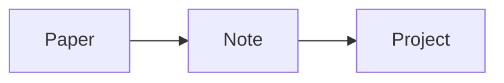

# Kitchen sink

Plain text with **bold**, *italic*, ~~strike~~, `inline code` and a [web link](https://example.org).
A #tag, a link to [[Other]], one to [[Other#Results|its results]], and a [[Missing note]].

Citations: [@cuiVariational2015, p. 4], several [see @cuiVariational2015; @ghost2000] and [-@cuiVariational2015].

Money is not math: it costs $5 and $10.
Inline math $E = mc^2$ and $\alpha_i \leq \beta$; display on one line $$\int_0^1 x\,dx$$. Escaped: \$5 and $x$.

$$
\sum_{n=1}^{\infty} \frac{1}{n^2} = \frac{\pi^2}{6}
$$

## Lists and tasks

- first
- second
  - nested
1. one
2. two

- [ ] an open task
- [x] a done task

## Quotes and callouts

> A plain quote.

> [!note] A note callout
> With a second line.

> [!warning]
> Careful: no title given.

## Table

| Method | Error | Notes |
|---|---:|---|
| MPS | 1e-6 | fast |
| Exact | 0 | slow |

## Code

```python
def f(x):
    # comment
    return x**2  # [@notacite] stays code
```



## Images and embeds


![[Other]]

---

A footnote reference[^1].

[^1]: The footnote text.

<script>alert("never runs")</script>
